<div align="center">

# Snake II

Taking a Nokia 3310 classic apart, twice: a hand-built Java remake in 2021, and in 2026 a browser edition that is checked, message by message, against the phone's own program.

[▶ Play it now](https://gamekiller168.github.io/snake_ii/) · [How to play](#play-v20) · [2021: the Java remake](#2021-the-java-remake) · [2026: reading the real game](#2026-reading-the-real-game) · [Evidence ledger](web/FIDELITY.md)

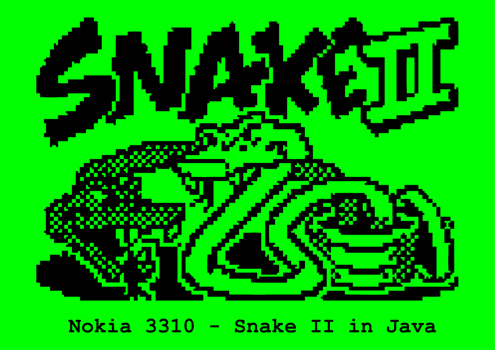 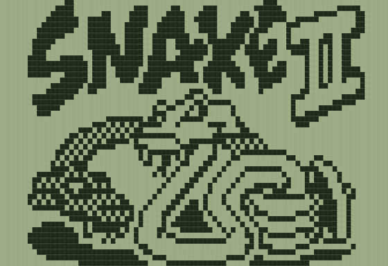

<sub>The cover of the 2021 write-up, and v2.0 in a browser in 2026 (this recording was played by a bot).</sub>

</div>

Snake II is the snake game that came with the Nokia 3310. This repository follows one hobby project around it, in two chapters. In 2021 it was a Java program built from photos, videos, drawings and measurements of a working phone. In 2026 the same question was asked again with better tools: four gameplay recordings of real phones, a dump of the phone's firmware, and an AI assistant to do the measuring, the reading and the writing.

## Versions at a glance

| | v1.0, 2021 | v2.0, 2026 |
| --- | --- | --- |
| What it is | A Java Swing remake of Snake II with the Nokia look | The game of the real Nokia 3310 in a browser: start-up animation, menus, nine levels, six mazes and the rules of the phone |
| Built from | Photos, videos, drawings and measurements of a working phone | Footage of real phones and a firmware dump, with an AI assistant, tested against the real program |
| Where | [`Snake II/`](Snake%20II) and the [PDF write-up](Snake%20II%20Nokia%203310%20in%20Java.pdf) (Hungarian), tag `v1.0` | [`web/`](web), tag `v2.0` |
| Run it | [Run the 2021 build](#run-the-2021-build) | open `web/index.html` ([details](#play-v20)) |
| The story | [2021: the Java remake](#2021-the-java-remake) | [2026: reading the real game](#2026-reading-the-real-game) |

| When | What |
| --- | --- |
| May 2021 | The PDF write-up is exported (date of the file) |
| 13 Sep 2021 | The Java sources and the PDF are uploaded: tag `v1.0` |
| 12 Nov 2026 | First browser port of the Java code |
| 13 Nov 2026 | The browser edition is rebuilt as a recreation of the real game: tag `v2.0` |

The 2021 files are exactly as they were uploaded: `git diff v1.0 -- "Snake II" "Snake II Nokia 3310 in Java.pdf"` is empty.

## Play v2.0

**[▶ Play in your browser](https://gamekiller168.github.io/snake_ii/)** (GitHub Pages, deployed from `web/` on every push to `main`).

Or run it locally:

No build step, no dependencies, no server code: plain HTML, CSS and JavaScript.

- Open `web/index.html` in a browser (double click works), or
- `cd web && python3 -m http.server 8080` and go to <http://localhost:8080> (`npm run serve` does the same).

To publish it, copy the `web/` folder to any static web host (`tests/` and `package.json` are not needed there).

### Keys

The page is a phone: the display, the four function keys and the keypad. On a touch screen use the keys on the page.

| | Keyboard | Phone key |
| --- | --- | --- |
| Steer the snake | arrow keys, W A S D or the digit keys | 2, 4, 6, 8 (1, 3, 7, 9 turn the snake by 90 degrees towards that corner) |
| Scroll a menu | up / down arrows or W / S | the two scroll keys |
| Select | Enter or Space | the middle key |
| Back, pause | Backspace, Escape or C | the C key (in the game it pauses: the menu then starts with "Continue") |

Menu: New game, Level, Mazes, Top score, Instructions. The lists are circular. Choose a level (1 to 9) and a maze ("No maze" or Maze 1 to 5) before you start; a maze chosen while a game is paused throws that game away, as on the phone.

### The game

The field wraps around: leave on one side, come back on the other (unless a maze wall is in the way). Hitting a wall or your own body ends the game, but at the first blocked step the game waits 0.1 s for you to turn away. An apple is worth the level number in points. After every fifth apple a bonus creature appears for 20 steps; the sooner you catch it, the more it is worth. Level, maze and top score are kept in the browser (`localStorage`). There is no sound.

## 2021: the Java remake

The first chapter is a write-up from May 2021: a seven-page PDF, [`Snake II Nokia 3310 in Java.pdf`](Snake%20II%20Nokia%203310%20in%20Java.pdf), in Hungarian. Its pages are laid out like the game itself, black on LCD green, with a snake running along the border. What follows is that PDF in English, page by page, with its pictures cut out of the pages and with notes that tie them to the code in [`Snake II/`](Snake%20II) (tag `v1.0`). The translated passages are the author's own words from 2021.

### The challenge was the look

<table>
<tr>
<td valign="top" width="40%">
<p><b>Design</b></p>
<p>First of all I have to talk about how the game is displayed. For anyone who can program, putting together a simple snake game is no big challenge, that is a fact. In this project the challenge was designing and implementing the visual presentation.</p>
</td>
<td valign="top" width="60%">
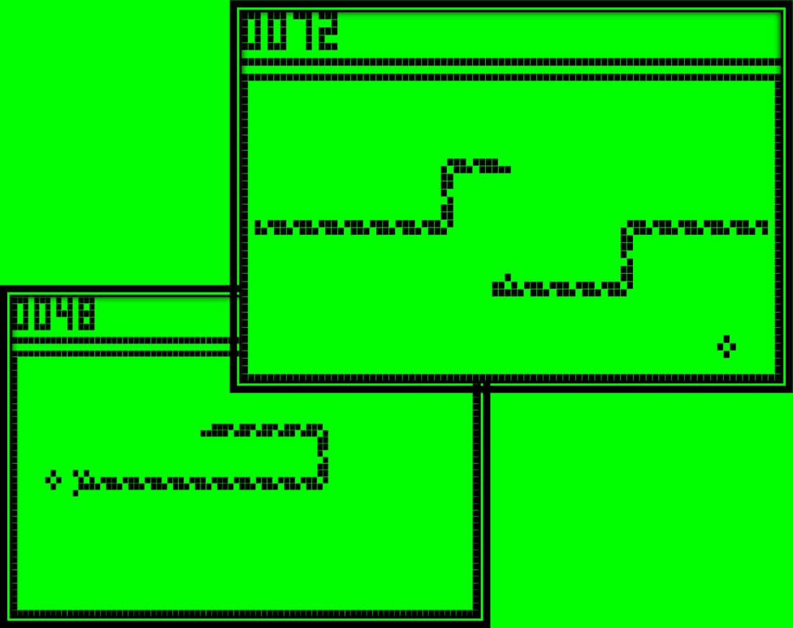<br>
<sub>Figure 1. The Java build in 2021 (PDF page 2).</sub>
</td>
</tr>
</table>

In the Java build every LCD pixel is a 10 x 12 px rectangle, so a window of 841 x 576 px shows the phone's 84 x 48 display. The score in the top left corner (0072 and 0048 above) is drawn from rectangles as well.

### A real phone as the reference

<table>
<tr>
<td valign="top" width="30%">
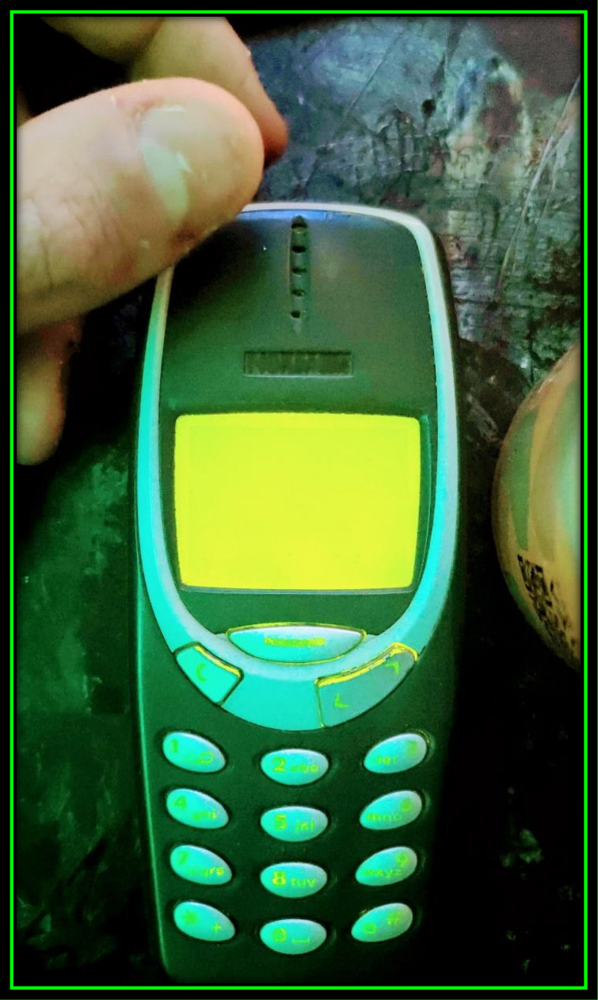<br>
<sub>Figure 2. A Nokia 3310 (PDF page 3).</sub>
</td>
<td valign="middle" width="70%">
<p>While testing the game, nostalgic feelings stirred in me, since as a child I played it a lot on an original Nokia phone. That phone still works to this day, although it is no longer what it was, because its battery no longer lasts for weeks...</p>
</td>
</tr>
</table>

<table>
<tr>
<td valign="top" width="50%">
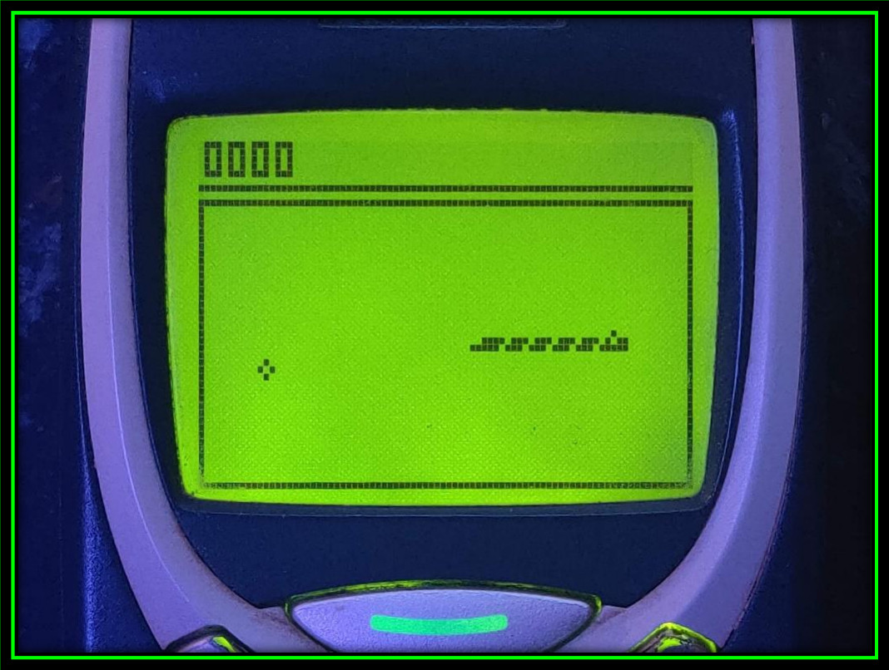<br>
<sub>Figure 3. The game on the phone's 84 x 48 display (PDF page 4).</sub>
</td>
<td valign="middle" width="50%">
<p>I took a lot of reference photos and videos so that I could make it completely "pixel-perfect" to the original. What also helped to get the 1:1 match is that the pixels in the game are not square but rectangular, just like on the Nokia's 84 x 48 display.</p>
</td>
</tr>
</table>

### From photos to numbers

This is what the references became in the 2021 code:

| What | In the 2021 build | Where |
| --- | --- | --- |
| Window | 841 x 576 px: 84 columns of 10 px, 48 rows of 12 px | `Screen.java` (`WIDTH`, `HEIGHT`) |
| One LCD pixel | a 10 x 12 px rectangle, so not square; the grid between the pixels is painted last, as green lines every 10 and every 12 px | `Screen.paint()` |
| Frame | black lines on rows 6 and 8, on columns 0 and 83 and on row 47 | `Screen.paint()` |
| Score | four digits of 3 x 5 pixels, 4 pixels apart, built from filled rectangles; score = (snake length - 9) x 4 | `Display.java`, `Screen.tick()` |
| Apple | a hollow ring of four pixels, placed on a 4-pixel lattice of 19 columns and 8 rows | `Apple.java`, `Screen.java` |
| Snake | pieces of three pixels in an L shape: eight body pieces and four heads, chosen by the direction each segment was travelling in | `BodyParts.java`, `Screen.paint()` |

All paths are below [`Snake II/src/`](Snake%20II/src).

### Drawings, and a first plan

<table>
<tr>
<td valign="top" width="38%">
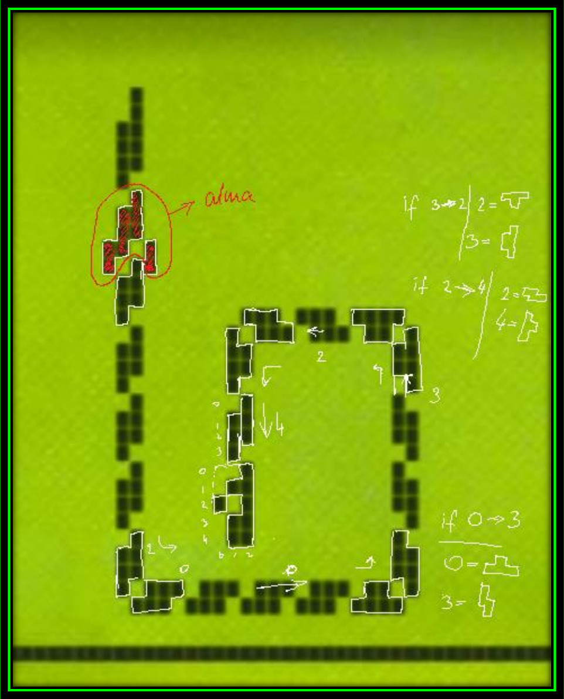<br>
<sub>Figure 4. A photo of the display, drawn over: the snake cut into pieces (white), the apple circled in red ("alma" is Hungarian for apple) and "if a to b" notes beside the sketched pieces (PDF page 5).</sub>
</td>
<td valign="middle" width="62%">
<p>The drawings in the picture show that I tried to break the snake's body down into uniform elements. As it usually goes, I did not code it that way in the end, because at the snake's turns many more elements would have been needed. In the end the snake is assembled from "L" shapes in every direction, and the corners are animated from these as well.</p>
</td>
</tr>
</table>

### The setback

<table>
<tr>
<td valign="top" width="38%">
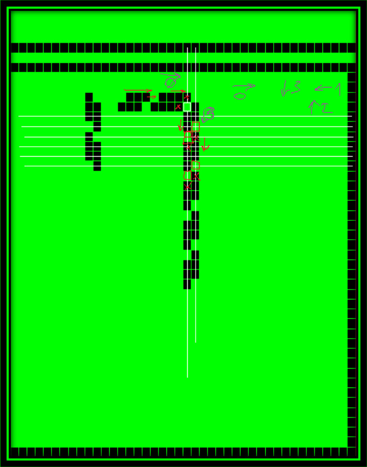<br>
<sub>Figure 5. The moment of realisation (PDF page 6). White lines mark the rows, red arrows and boxes mark where neighbouring pieces run into each other at a corner. The direction codes at the top right (0 right, 1 left, 2 up, 3 down) are the ones the code uses (<code>lastPressed</code> in <code>Screen.java</code>).</sub>
</td>
<td valign="middle" width="62%">
<p>In the picture on the left you can see the realisation: the moment I realise that this is not going to work, because at the corners the elements slide into each other. That was a real slap in the face, since I knew I would have to redesign the whole display.</p>
</td>
</tr>
</table>

The way out is in [`BodyParts.java`](Snake%20II/src/entities/BodyParts.java): `part1` to `part8` are the body pieces, `head0` to `head3` the heads, and `Screen.paint()` picks the pieces of each segment from the direction it was travelling in.

### Controls and goal

> <b>Controls</b>
>
> The snake can be steered in several ways. One option is the WASD keys, another is the arrow keys, and the third is the 8 4 6 2 keys of the numeric pad.
>
> <b>How do you play?</b>
>
> Simple. You have to steer the snake towards the apple without running into its own tail.
>
> <b>The goal of the game</b>
>
> To reach the maximum score (I have never reached it, so I do not know how high it is).
>
> <sub>From page 7 of the PDF.</sub>

A note on the code: the sources that were committed in 2021 are the display and the movement. They handle the arrow keys only (class `Key` in `Screen.java`) and contain no wall, wrap-around or self-collision handling, no game over and no menu, so the rules described above are not in them. v2.0 supports all three ways of steering, see [Keys](#keys).

<details>
<summary>The original PDF, page by page (Hungarian)</summary>

<p align="center">
 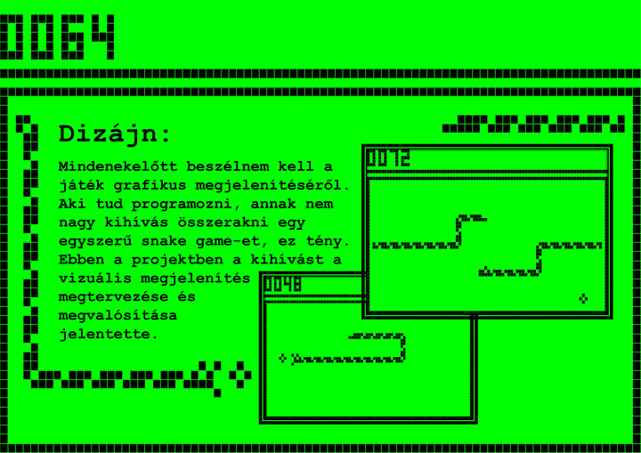<br>
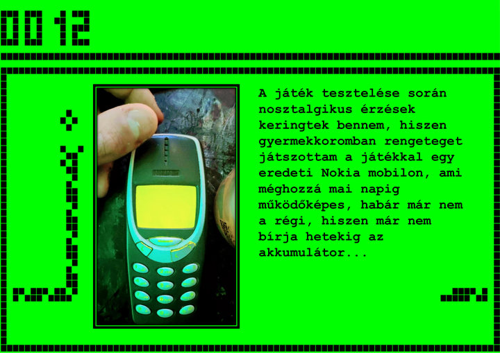 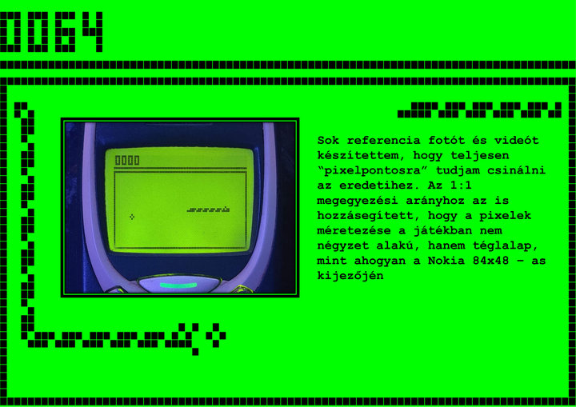<br>
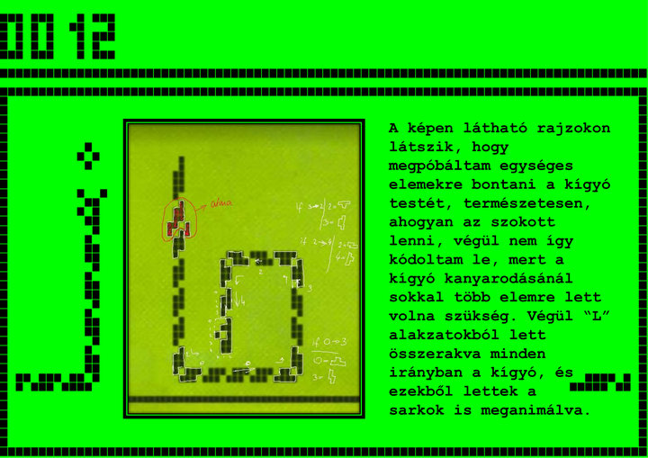 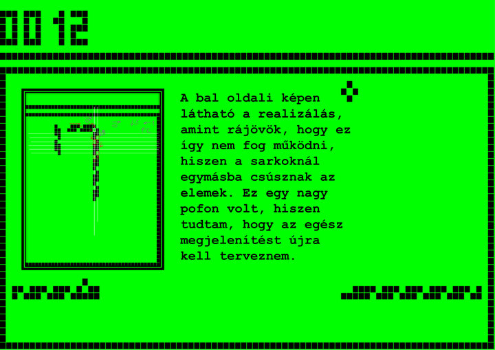<br>
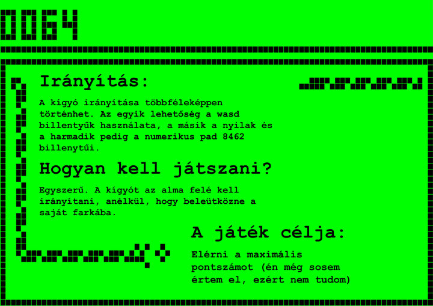
</p>

</details>

### What 2021 got right, and what it could not know

In 2021 the only way in was from the outside: look at a working phone, photograph it, draw over the photos, measure. How close did that get? The right-hand column is what the 2026 work found out from footage and from the firmware (the evidence for each line is in [`web/FIDELITY.md`](web/FIDELITY.md)).

| | The 2021 build | 2026: footage and firmware |
| --- | --- | --- |
| LCD pixel | 10 x 12, not square | measured 10.008 x 11.967 in footage: the proportion was right |
| Frame | lines on rows 6 and 8, columns 0 and 83, row 47 | the same lines, checked against the program's own picture |
| Score digits | 3 x 5 pixels in 4-pixel boxes | the same |
| Apple | a hollow ring of four pixels, 19 x 8 positions | the same ring (measured over 51 apples); the real field has 20 x 9 cells, so the last column and the last row were never used in 2021 |
| Points | 4 per apple | the level number per apple; after every fifth apple a bonus creature appears |
| Snake | L-shaped pieces | straight pieces, corners, heads (mouth opens when food is next), tails and a bulge for swallowed food; the picture library reproduces 470 of 482 tracked frames pixel for pixel, the other 12 differ in one marginal LCD pixel |
| Speed | one speed, set by counting passes of a loop | nine levels, from 660 ms per step at level 1 down to 90 ms at level 9 |
| Rules | movement only | wrap-around field, a crash with 0.1 s to turn away, game over, six mazes, menus |

### Run the 2021 build

The compiled classes of 2021 are in the repository and still run on a current Java:

```
java -cp "Snake II/bin" Snake.Frame
```

To compile the sources yourself:

```
cd "Snake II"
javac -d out $(find src -name '*.java')
java -cp out Snake.Frame
```

Use the arrow keys. The program writes the apple position and the score to the console.

## 2026: reading the real game

In November 2026 the project went back to the same question with different tools. The aim changed from "make it look like the Nokia" to "make it behave like the Nokia, and show the proof". The first attempt, a port of the 2021 code to the browser, is still in the git history; it was replaced by a recreation of the real game. The commits are dated 12 and 13 November 2026, and they are authored by Claude, the AI assistant that did the analysis and wrote the code (see [Working with an AI](#working-with-an-ai)).

### What every element rests on

Nothing in v2.0 is invented to fill a gap. Every element carries a tag that says what it rests on, in the code and in [`web/FIDELITY.md`](web/FIDELITY.md):

| Tag | Meaning |
| --- | --- |
| FW | read from the program of a real 3310 (firmware v6.39, English) |
| PHONE | a time, a count or a behaviour observed on a real phone in footage |
| VIDEO | a picture or a position read from filmed frames of real phones, with the error given where it is not exact |
| EST | an estimate: nothing measured, nothing read. It is marked as one and replaced as soon as better evidence exists |

Two independent sources feed it, and the real program is used as a judge:

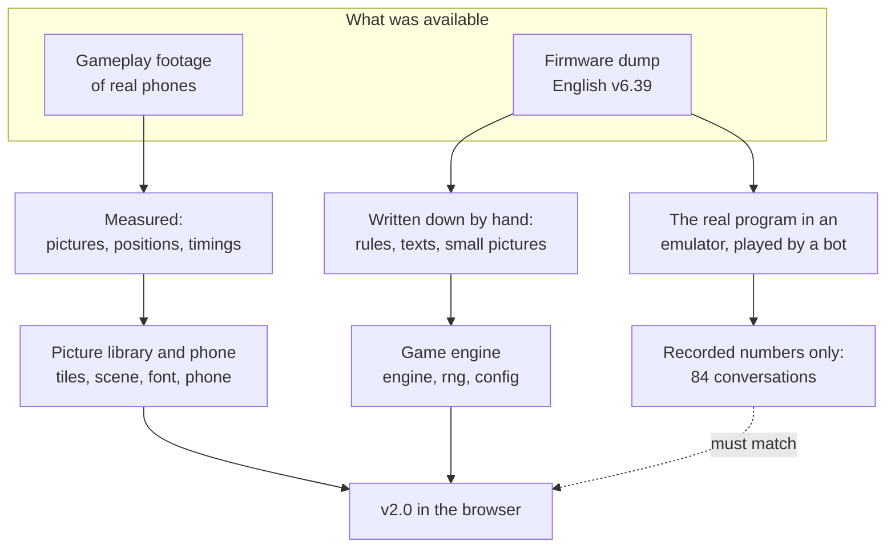

Where footage and program could be compared (the step time of level 1, the bonus counter and its value, the crash timing, the pictures of the snake) they agree.

### Source 1: gameplay footage

Four recordings of real phones were measured frame by frame. Titles and names are as they appear in the file names of the clips; no frame from them is stored in this repository.

| Clip | What it is | Used for |
| --- | --- | --- |
| A | "Playing Snake 2 At Full Speed" (91 Pixels), 1080 x 1920, 30 fps, 56 s, English, green LCD | the game over and top score notes, the fireworks |
| B | "Snake II on Nokia 3310 - varjoisa", 1920 x 1080, 30 fps, 481 s, English, blue backlight, one long game at the default level | pictures of snake, apple and bonus creatures, the header, menus, notes, timings |
| C | "Snake 2 Original ... ASMR - Handheld Gameplayer", real sound | nothing yet: v2.0 has no sound, and the display is too small in this clip to read pixels |
| D | "Snake II on Nokia 3310 (4K) - JAVA Mobile Games", 1920 x 1080, 30 fps, 308 s, Russian UI, close-up | menus, level screen, maze list, the "maze selected" note; only what does not depend on the language |

What the footage gave:

- the proportions of the display: 10.008 x 11.967, which is the 10 : 12 of 2021
- the apple, a hollow 3 x 3 ring, measured over 51 apples
- the snake: 482 tracked frames of clip B; the picture library reproduces 470 of them pixel for pixel and the other 12 differ in one marginal LCD pixel (183 measured frames are checked bit by bit in `web/tests/tiles.test.js`)
- timings: 0.657 to 0.662 s per step at level 1 in clip B; the bonus creature is worth 2 x counter + 10 in all seven captures at level 1
- the start-up animation (2700 ms) compared with footage frame by frame; the six fireworks pictures (230 ms each) identified in clip A by correlation

### Source 2: the firmware dump

The second source is the phone itself. A flash dump of the English firmware v6.39 of the 3310 (MCU and PPM images) was read to find what footage can only hint at. It contributed three kinds of things, all written down by hand and re-implemented rather than copied:

- numbers and rules: the nine step times (660, 480, 380, 300, 230, 180, 140, 110 and 90 ms), how points and bonus creatures are worked out, the timeline of a crash and the program's own random number generator (`config.js`, `engine.js`, `rng.js`)
- the English texts of the menus (`texts.js`)
- small pixel pictures: the start-up animation, the fonts, the fireworks and the bonus creatures (`pictures.js`)

No firmware file, no program code and no table from it is in this repository. `.gitignore` keeps a `reference/` folder (firmware dumps, footage, extracted bitmaps) out of it.

### Proof: replaying the real program

The strongest check does not use footage at all. The phone's own program was run in an emulator while a bot played it, and every exchange was recorded: the messages the game receives (start, step, timer, keys) and what it answers. The engine of v2.0 is written in the shape of that message interface, so the same conversations can be replayed against it. After every single message it has to give the same return code, the same delays, the same event code and score, and a picture with the same CRC-32 as the program's 84 x 48 picture.

- 84 conversations with 26,846 messages, over all nine levels and all six mazes, with deliberate crashes, turns inside the grace time, bonus creatures of all six kinds eaten and expired, and snakes that wrap around the end of the program's ring buffer
- 440 placement cases for the program's two random placement routines
- the recorded conversations are in [`web/tests/fixtures`](web/tests/fixtures) as numbers only (`traces.json`, `placement.json`); nothing of the program is in them

### Working with an AI

The 2026 edition was built in sessions with Claude, an AI model by Anthropic (Claude Sonnet 5.5 in the commit trailers). The author brought the question, the footage and the firmware, and decides what goes into the repository. Claude did the work in between: measuring the footage frame by frame, reading the firmware, writing the engine, the picture library, the phone model, the page and the tests, and keeping the evidence ledger. The commits of 12 and 13 November 2026 are authored by Claude and carry a `Co-Authored-By` trailer.

What keeps that honest is checking, not trust: every claim has an evidence tag, estimates are labelled as estimates, and the engine has to reproduce the real program's answers. Whatever could not be settled is listed as open instead of being filled in.

### What it looks like

<p align="center">
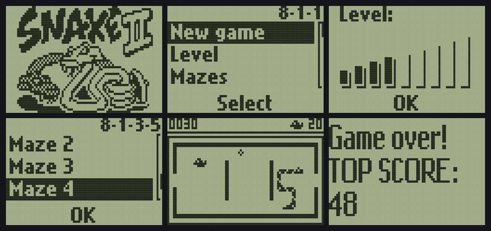<br>
<sub>Six screens of v2.0, captured from the build with a headless browser: start-up picture, main menu, level screen, maze list, a game in a maze with a bonus creature, game over with the top score.</sub>
</p>

<p align="center">
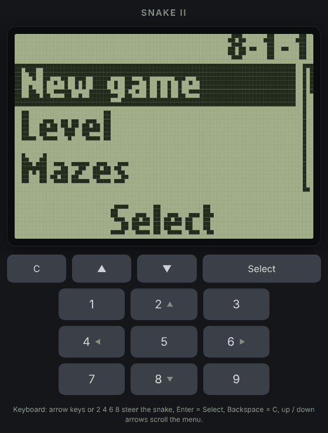<br>
<sub>The page around the display: the function keys and the keypad for touch screens.</sub>
</p>

### What is still open

Not everything is known yet. [`web/FIDELITY.md`](web/FIDELITY.md) lists every element with what it rests on and what would settle the estimates. The main gaps:

- sound is not in v2.0: clip C has the real sounds, but nothing was made up instead
- the special bonus item is not in v2.0: the program rolls for it, but it is switched off in the phone and never appeared in any footage
- a few glyphs of the large font (0 3 5 6 c s), the tick in the "Maze n selected" note and the icon of the top score note are estimates or missing; the instruction pages come from the program only, because no footage shows them in English
- bonus creatures 0 and 3 match the program's picture but were never seen on a real phone, and the mazes were checked against the program but not yet against footage

If you own an English Nokia 3310: footage that is straight on, close, in focus, without zoom changes and at 60 fps if possible, of the points listed under "Open" in the ledger, would settle most of these.

## The code

v2.0 replaces the first browser version, which was a port of the 2021 code with a design of its own. Everything in it is taken from the real thing:

- `web/js/engine.js`, `rng.js`, `config.js`: the game logic, written by hand from the rules of the phone's program and tested against it.
- `web/js/tiles.js`, `scene.js`, `font.js`: the pictures of the game (snake, apple, bonus creatures, score), read from filmed frames of real phones and checked against 183 measured frames and against the program's pictures.
- `web/js/phone.js`, `screens.js`, `text.js`, `pictures.js`, `texts.js`: the phone around the game (start-up animation, circular menus, level screen, maze list, notes, pause, fireworks for a new top score) on a virtual clock, with the times and positions measured in footage.
- `web/js/lcd.js`, `input.js`, `main.js`, `store.js`, `framebuffer.js`, `index.html`, `css/`: the page: the LCD painter (pixels 10 : 12 like the real display), keys, layout, the place where level, maze and top score are kept, and the 84 x 48 bit matrix everything is drawn into first.

```
Snake II/                          the 2021 Java Swing sources (tag v1.0, never modified)
Snake II Nokia 3310 in Java.pdf    the 2021 write-up (Hungarian)
web/                               v2.0, the browser edition: no build, no dependencies
  index.html, css/, js/            the page and the game
  tests/                           the tests and their fixtures (numbers only)
  FIDELITY.md                      the evidence ledger
docs/img/                          the pictures on this page
```

### Tests

`cd web && node --test` (developed with Node 22, nothing to install): 358 tests. The engine against the recorded program, the picture library against measured frames, the phone on its virtual clock (start-up, menus, mazes, pause, crash, game over, fireworks), the pictures, keys and storage.

## Credits and legal

The Java remake and the 2021 write-up are the author's (Hunor, GameKiller168); so are the choice of footage and firmware and the decisions about what to publish. The browser edition was built with Claude (Anthropic). The four clips in the footage table belong to their makers and are not part of this repository.

The pictures on this page are in `docs/img`. The title picture, the figures and the page images are cut from the 2021 PDF; the screens and the GIF were captured from the v2.0 build (the GIF is a bot playing). No frame from the third-party clips is used.

Snake II and the Nokia 3310 belong to their rights holders. This is an unofficial fan recreation, made to preserve how the game looked and behaved; it is not affiliated with or endorsed by them. The small pixel pictures in v2.0 (start-up animation, fonts, fireworks, bonus creatures) are copies of Nokia's artwork at 84 x 48 resolution. The title picture at the top of this page, which is also the cover of the 2021 PDF, is the phone's start-up artwork as well. That is where Nokia's work lives in this repository. No firmware file, program code or table from the firmware is in it.

## Magyarul

Ez a repó a Nokia 3310 Snake II-jének két feldolgozása. A `v1.0` a 2021-es Java-verzió (`Snake II/`, változatlanul); a hozzá tartozó PDF magyarul van meg (`Snake II Nokia 3310 in Java.pdf`), a fenti 2021-es fejezet ennek az angol átirata a képeivel együtt. A `v2.0` a valódi Nokia 3310 Snake II-je böngészőben, a `web/` mappában: indítási animáció, körkörös menük, 9 szint, 6 pálya (labirintus), a telefon szabályai.

A 2026-os fejlesztés MI-vel (Claude) készült. A képek és az időzítések valódi telefonokról készült videókból vannak mérve, a szabályok a telefon firmware-éből kiolvasva és kézzel újraírva, a játékmotort pedig 84 rögzített beszélgetéssel teszteljük a telefon saját programjával szemben. Hogy melyik elem mire épül (a telefon programja, videó vagy becslés), azt a [`web/FIDELITY.md`](web/FIDELITY.md) tartalmazza.

Megnyitás: `web/index.html`, vagy statikus szerver (`cd web && python3 -m http.server 8080`). Nyilak / WASD a kígyóhoz, Enter vagy Szóköz a középső gomb, Backspace / Esc / C a C gomb (játék közben szünet). Hang egyelőre nincs.
